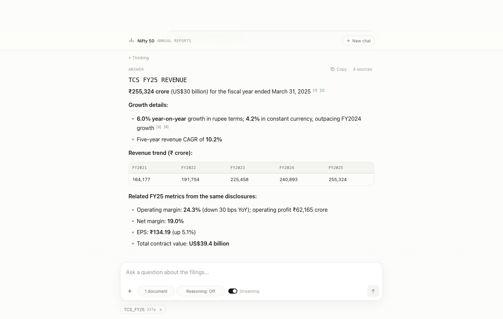

# Nifty 50 — Annual Report Q&A

A small HTTP service that answers questions over 51 Nifty-50 FY25 filings.
Indexing and retrieval run through the [PageIndex](https://github.com/VectifyAI/PageIndex)
client: documents are turned into a hierarchical tree index, and an agent
searches that tree with tools instead of a vector database. The service adds a
single-page UI, a JSON/SSE API, caching, concurrency limits, and optional
bearer auth.

- **Index:** local PageIndex tree store (`.pageindex/`, one tree per PDF)
- **Retrieve:** `PageIndexClient.chat` over the OpenCode Go provider
- **Serve:** Starlette + uvicorn, one HTML page, five API routes
- **Data:** 51 filings, 20,854 pages, page-level citations



*Example: TCS FY25 revenue, answered from the indexed tree with page-level citations (`docs/demo.png`).*

## Layout

```
.
├── server.py             HTTP service: routes, cache, auth, metrics
├── index_pdfs.py         batch indexer (PageIndexClient)
├── index.html            single-page UI served at /
├── run_server.sh         launcher (uses .venv and .env)
├── requirements.txt      runtime dependencies
├── requirements-dev.txt  test dependencies
├── tests/                server tests (no network, fake client)
├── data/pdfs/            51 source PDFs (public filings, included)
├── .pageindex/           indexed tree store (gitignored, generated)
├── results/              one tree JSON per PDF (included)
├── .env.example          configuration template
└── Dockerfile            production image
```

## Requirements

- Python 3.10+
- An OpenCode Go API key
- The corpus is included in `data/pdfs/` as `<SYMBOL>_FY25.pdf` (51 files); its
  result trees are in `results/`

## Setup

```bash
python3 -m venv .venv
.venv/bin/pip install -r requirements-dev.txt
cp .env.example .env
# edit .env and set OPENCODE_GO_API_KEY
```

The filing corpus (`data/pdfs/`, ~887 MB) and its result trees (`results/`) are
included, so the repository is large. `.venv/` and `.pageindex/` are gitignored:
run the indexer once to build the store, or copy a store you already have.

## Run

```bash
./run_server.sh
# http://127.0.0.1:8000
```

`run_server.sh` reads `.env`, then the environment. Single worker by default;
`WORKERS=2 ./run_server.sh` starts two uvicorn workers.

## Configuration

Every default is in [`.env.example`](.env.example). Environment values win over
built-in defaults; CLI flags win over environment values.

### Provider and server

| Variable | Default | Purpose |
|---|---|---|
| `OPENCODE_GO_API_KEY` | required | OpenCode Go key for indexing and chat |
| `OPENCODE_GO_BASE_URL` | `https://opencode.ai/inference/go/openai/v1` | provider endpoint |
| `PAGEINDEX_MODEL` | `deepseek-v4.1-flash` | model for both indexing and chat |
| `PAGEINDEX_STORE` | `./.pageindex` | local tree store |
| `HOST` / `PORT` | `127.0.0.1` / `8000` | bind address |
| `WORKERS` | `1` | uvicorn workers |
| `LOG_LEVEL` | `INFO` | log level |
| `API_TOKEN` | unset | when set, `/api/*` and `/metrics` require `Authorization: Bearer <token>` |

### Budget limits

These are the enforced caps. `GET /health` reports the agent and retrieval
budgets under `budgets`; `GET /metrics` reports all of them.

| Variable | Default | Enforced at |
|---|---|---|
| `MAX_CONCURRENT` | `8` | semaphore: in-flight agent runs per worker |
| `QUEUE_TIMEOUT` | `45` | seconds to wait for a slot, then `503` |
| `MAX_BODY_BYTES` | `65536` | request body size, then `413` |
| `MAX_QUESTION_CHARS` | `1000` | question length, then `400` |
| `MAX_DOC_IDS` | `64` | document IDs per question, then `400` |
| `MAX_TURNS` | `10` | agent turns per question (PageIndex default; passed as `max_turns`) |
| `MAX_OUTPUT_TOKENS` | `4096` | per-turn output cap; `0` leaves the provider default |
| `TOOL_RESPONSE_CHARS` | `100000` | one tool reply, in characters (95% usable) |
| `TOOL_MAX_PAGES` | `10000` | pages one page-content request may name |
| `TOOL_SUGGESTIONS` | `3` | similar-name suggestions on a miss |
| `CATALOG_CHARS` | `6000` | document list injected per question; above it, the list is dropped |
| `DOCUMENT_CATALOG` | `1` | `0` stops injecting the document list |
| `ANSWER_CACHE_TTL` | `3600` | answer-cache seconds; `0` disables |
| `ANSWER_CACHE_MAX` | `500` | cached answers per worker |

`TOOL_RESPONSE_CHARS`, `TOOL_MAX_PAGES`, and `TOOL_SUGGESTIONS` are applied to
the PageIndex in-process tool layer at startup: the server sets the SDK
constants the tools read on every call. `MAX_OUTPUT_TOKENS` is sent as the
chat lane's wire `max_tokens` through the SDK's `extra_body` channel.

### Indexing budgets

| Variable | Default | Purpose |
|---|---|---|
| `INDEX_MODE` | `flash` | `flash` or `standard` tree builder |
| `INDEX_CONCURRENCY` | `16` | parallel summary calls per PDF (`0` = SDK default 128) |
| `INDEX_OPTIMIZE` | `merge` | `full` (merge + LLM expand), `merge`, `off` |
| `INDEX_PAUSE` | `2` | seconds between PDFs |
| `INDEX_SUMMARY_MAX_WORDS` | `150` (unset → SDK default) | word cap per node summary |
| `INDEX_REASONING_EFFORT` | `none` | reasoning effort for summary/expand calls |
| `INDEX_JSON_DIR` | `./results` | result-tree output directory (`''` disables) |

CLI flags (`--mode`, `--concurrency`, `--optimize`, `--summary-max-words`,
`--pause`, `--store`, `--json-dir`) override the environment for one run.

## API

| Method | Path | Description |
|---|---|---|
| `GET` | `/` | the chat UI |
| `GET` | `/health` | liveness: model, store, version, uptime |
| `GET` | `/ready` | readiness: store manifest present, document count |
| `GET` | `/metrics` | counters, gauges, p50/p95 latency |
| `GET` | `/api/documents` | indexed documents (`id`, `name`, `pages`) |
| `POST` | `/api/ask` | one question → `{answer, citations}` |
| `POST` | `/api/ask/stream` | one question → SSE frames |

Ask request:

```json
{"question": "What was TCS's FY25 revenue?", "doc_ids": ["pi-..."], "reasoning_effort": "low"}
```

`doc_ids` and `reasoning_effort` are optional. With `doc_ids` omitted the agent
searches the whole library; `reasoning_effort` is one of
`none`, `low`, `medium`, `high`.

```bash
curl -s http://127.0.0.1:8000/api/ask \
  -H 'Content-Type: application/json' \
  -d '{"question":"What was TCS FY25 revenue?"}'
```

SSE frames on `/api/ask/stream`: `{"delta": "..."}` for answer text,
`{"thinking": "..."}` for process text, `{"to_thinking": "..."}` when prior
text is retracted into the thinking log, `{"tool": "..."}` on a tool call, and
one final frame `{"answer", "thinking", "citations", "done": true}`. Errors
arrive as `{"error": "..."}`. A cached answer replays two frames.

With `API_TOKEN` set:

```bash
curl -H "Authorization: Bearer $API_TOKEN" ...
```

Errors are JSON: `400` invalid input, `401` missing/wrong token, `413` body
too large, `415` non-JSON content type, `502` retrieval failure, `503` busy.

## Indexing

```bash
.venv/bin/python index_pdfs.py                    # every data/pdfs/*.pdf
.venv/bin/python index_pdfs.py --force            # re-index all
.venv/bin/python index_pdfs.py data/pdfs/TCS_FY25.pdf
.venv/bin/python index_pdfs.py --json-dir ''      # store only, no results/
```

The indexer skips documents whose filenames are already in the store, retries
transient provider errors (rate limits cool down for 45 s, gateway errors for
30 s then 60 s), writes result JSON atomically, and takes an exclusive
`.index.lock` so two runs cannot write one store at once. Do not index into a
store while the server is serving it.

Budgets come from `INDEX_*` variables (see above), so a deployment can set
them once in `.env`; CLI flags override them per run. Defaults keep concurrency
at 16 summaries and `--optimize merge`, measured on this corpus to avoid
OpenCode Go rate limits and oversized expand prompts. `--concurrency 128
--optimize full` restores the library's defaults.

## Testing

```bash
make test
# or
.venv/bin/python -m pytest -q
```

The tests use a fake PageIndex client, so they run offline and never touch the
store, the provider, or `data/pdfs/`.

## Docker

```bash
docker build -t nifty-rag .
docker run --rm -p 8000:8000 --env-file .env \
  -v "$PWD/.pageindex:/data/.pageindex:ro" nifty-rag
```

The image contains code and dependencies only. Mount the store read-only for
serving; mount `data/pdfs` and a writable store for indexing. The image creates
`/data` owned by the app user (uid 10001), so a named volume inherits writable
ownership; a host bind mount must be writable by that uid for indexing.

## Operations notes

- One worker is the default because answer caches, metrics, and semaphore
  counters are per process; with N workers each has its own copy.
- The store is read-mostly at serve time. The indexer takes `.index.lock`;
  the server never writes.
- Logs are timestamped lines with a request ID on every response
  (`X-Request-ID`); auth rejections and retrieval failures are logged. uvicorn
  access logging is disabled so each request logs once.
- Identical questions arriving together share one agent run (single-flight);
  the followers replay the leader's answer.
- Every response carries `nosniff`, `DENY`, `no-referrer` and a strict
  Content-Security-Policy; the UI loads no external assets.
- `/health` is safe for liveness probes; `/ready` returns 503 when the store
  manifest is missing.

## License and attribution

MIT — see [`LICENSE`](LICENSE). The retrieval engine is
[PageIndex](https://github.com/VectifyAI/PageIndex), MIT-licensed and used as a
dependency (no PageIndex source is vendored in this repository). The annual
reports in `data/pdfs/` are public company filings, included for reproducibility
and remaining the property of their issuers.
